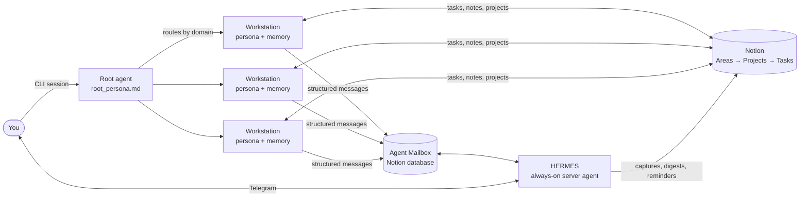

# Atlas Agent OS

**A file-based operating system for a personal multi-agent AI assistant.**

Atlas is the system I use to run my studies, work and side projects with AI agents. It is not a framework you install. It is a set of conventions: plain Markdown files that any CLI agent with file access (Claude Code, Gemini CLI, Antigravity and similar) can read, plus Notion as the shared database and an always-on server agent for the hours when the laptop is off.

This repository contains the conventions as reusable templates. My own memory files stay private.

A visual companion, [Atlas Realm](https://github.com/Arianabdl/atlas-realm), draws the whole system as a pixel-art RPG map.

## Architecture

| Piece | What it is |
| :-- | :-- |
| **Root agent** | `root_persona.md`: execution rules, memory rules and a routing map to every workstation |
| **Global memory** | `global_memory.md`: facts and preferences that span domains |
| **Workstation** | One folder per domain (career, thesis, sport, music…) with `<name>_persona.md` (behavior) and `<name>_memory.md` (facts) |
| **Notion** | Source of truth for tasks, projects and notes, in a strict three-level tree |
| **Agent Mailbox** | A Notion database every agent writes to; the only channel between agents |
| **HERMES** | The one agent that runs 24/7 on a small server: Telegram capture, daily digests, reminders |

## Core rules

1. **Behavior vs. fact.** A rule that says *always / never / before X do Y* goes in a persona file. A fact that can change goes in a memory file.
2. **100-line limit.** Every persona and memory file stays under 100 lines. When one gets close: summarize, then move whole sections into sub-files and leave a routing pointer. Small files keep the context window clean.
3. **Surgical edits only.** Agents update a section or a checkbox. They never rewrite a whole memory file.
4. **No orphans in Notion.** Every task belongs to a project, every project to an Area. Archived pages are ignored everywhere.
5. **One channel between agents.** All agent-to-agent messages go through the Agent Mailbox with a fixed format (Request / Context / Constraints / Expected Output).
6. **Ask before planning.** When a task is created, the agent asks for timing, duration and priority before saving it.

Full details: [`docs/agent_system_manual.md`](docs/agent_system_manual.md) · Notion setup: [`docs/notion_schema.md`](docs/notion_schema.md)

## Repository layout

| Path | Contents |
| :-- | :-- |
| `templates/` | Root persona, global memory, workstation persona and memory templates |
| `examples/linkedin/` | A complete workstation: a LinkedIn strategist and ghostwriter agent |
| `skills/create-workstation/` | A skill that scaffolds a new workstation and registers it in the routing map |
| `docs/` | System manual and Notion schema |

## Start your own

1. Copy `templates/root_persona.md` and `templates/global_memory.md` to an empty folder (your `agent_workspace`).
2. Create the Notion databases from `docs/notion_schema.md` and write their IDs into `00_Resources/notion_map.md`.
3. Add workstations with the `create-workstation` skill, or by copying the workstation templates.
4. Point your CLI agent at the folder and tell it to read `root_persona.md` first.

## Lessons from running it

- **One always-on agent beats several.** I first ran a planner, a librarian and a Notion agent as separate server services. Keeping three agents alive and in sync cost more than it gave, so I shut them down and kept a single server agent (HERMES). The other roles now run on demand in local sessions.
- **Small local models were not enough on a laptop GPU.** On a 4 GB GPU, 4B–8B models gave about 2 tokens per second and failed most tool calls, so the server agent uses a hosted LLM API.
- **Secrets drift into files.** Tokens pasted into scripts spread into dozens of files and into git history. Everything now reads from `.env`, and repositories are scanned (history included) before anything goes public.
- **Chat apps eat markup.** Telegram treats `__` and `**` as formatting, so code sent to the server agent through Telegram arrived broken. Long code goes over a remote desktop instead.
- **Memory files hold what Notion can't.** Decisions, contacts and status notes live in memory files; tasks live in Notion. Each session starts by syncing the two.

## License

MIT
